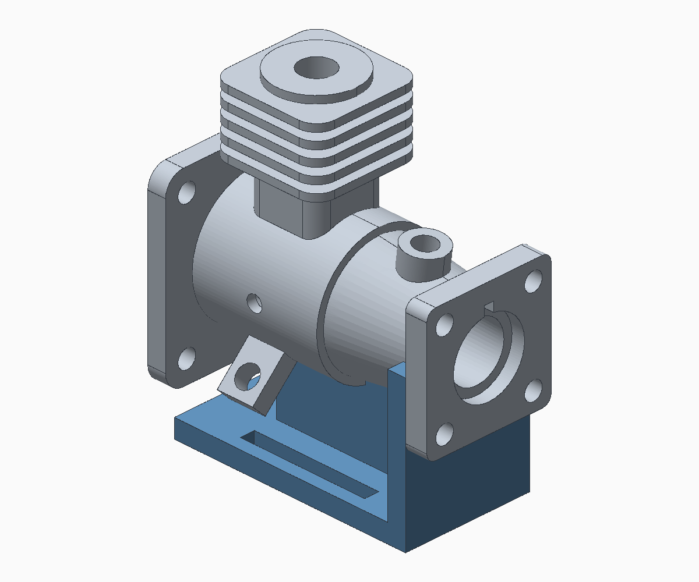
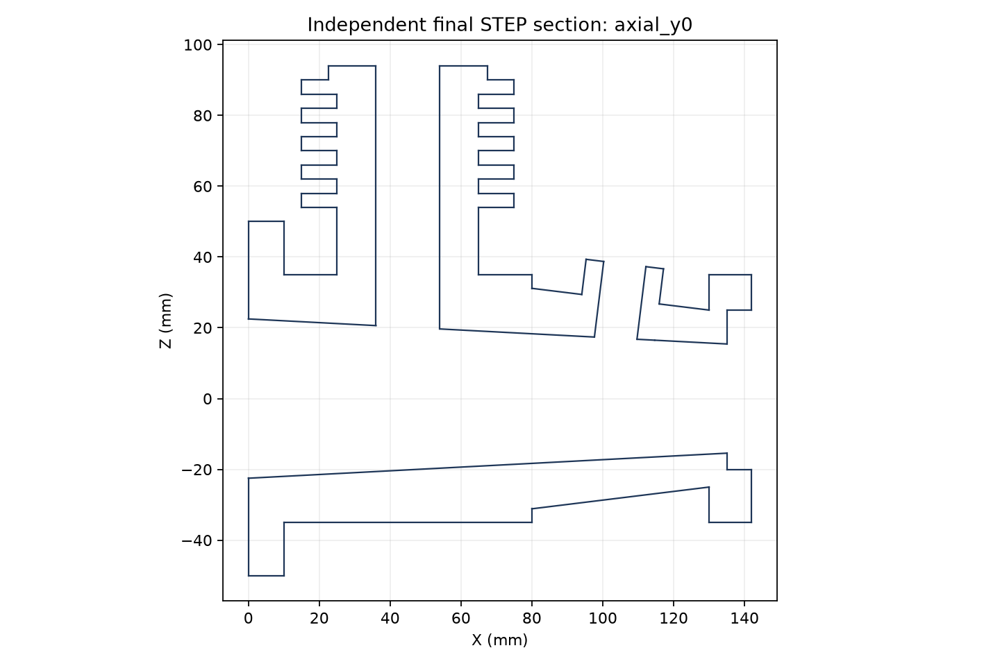

# Deng drawing-to-CAD agent experiment

Reproduce the scoring, rebuild the saved CAD submission, or run a new restricted agent trial adapted from **Deng, Chen and Olechowski (2024)**, [*What Sets Proficient and Expert Users Apart? Results of a Computer-Aided Design Experiment*](https://doi.org/10.1115/1.4063360).

This private research repository contains one completed **GPT-6.1 Sol (`gpt-6.1-sol`), `xhigh`** trial. The agent finished in **11 minutes 16 seconds**, including shutdown, and used **one of four** available geometry-check calls. Automatic measurements and AI-assisted operator review confirmed **60 of 61 criteria**. One blind-hole depth convention remains unresolved. All eight integrity and supplemental gates passed; overall acceptance is still **`requires_review`**.



*Candidate-produced render of the sealed submission. Independent measurements, not this rendering, determine the score.*

## Reproduce the recorded score

Requires Python 3.10 or newer and its standard library. No CAD installation, model login, network request, or submitted-code execution is involved:

```sh
python3 scripts/replay.py --mode score
```

Expected result: `confirmed_correct: 60`, `denominator: 61`, one `requires_review`, and `recorded_outcome_differences: []`. This recomputes the score from the saved independent measurements and protected review; it does not simply print the archived total. It checks the exact candidate-file inventory and hashes, snapshot binding, rubric hash, and per-criterion/gate outcomes. It does **not** repeat geometric measurements or reviewer judgments.

## Rebuild and measure the saved CAD

The restricted native path is qualified for **macOS on Apple Silicon**. It uses the original no-fork Seatbelt worker, CPython 3.12.14, CadQuery 2.8.0 and pinned dependencies. See [runtime setup](runtime/README.md) for the copied-runtime and standalone-install paths. Runtime binaries and credentials are excluded from this repository.

With a runtime installed at `/absolute/deng-runtime`, choose a new output directory:

```sh
python3 scripts/replay.py --mode full \
  --runtime-root /absolute/deng-runtime \
  --project-root /absolute/deng-replay
```

This performs a fresh restricted source rebuild, STEP reload, integrity/assembly checks and the 19 automatic criteria. It combines those new measurements with the same snapshot-bound 42-item operator review. **The operator measurements and design-intent judgments are reused, not independently repeated.** The full report is written under the selected project root; no model inference occurs.

## Run a new agent trial

New trials are opt-in and may produce different geometry, timing and scores. The repository is an operator-side package: **do not give the whole repository to the candidate**, because it includes grading material and the previous solution. The materializer copies only `agent-input/` into the candidate input area.

First materialize the templates at new, disjoint project and runtime paths, then qualify the relocated harness:

```sh
python3 scripts/materialize.py \
  --runtime-root /absolute/deng-runtime \
  --project-root /absolute/deng-new-trial

python3 scripts/qualify_harness.py \
  --project-root /absolute/deng-new-trial
```

Qualification uses fixed responses from a local simulated model service. It tests the actual CLI, tool gate, worker isolation, deadlines, snapshots and shutdown. It makes no provider inference requests. Relocated code receives a **new local freeze**; the original trial's freeze is retained as provenance and is not presented as qualification of different code.

Only after qualification, an explicit live command starts a separate synthetic transport preflight followed by the CAD trial:

```sh
python3 scripts/run_trial.py \
  --project-root /absolute/deng-new-trial \
  --auth-file /absolute/private-codex-auth.json \
  --live
```

The live adapter reproduces the original ChatGPT-authenticated Codex transport. Supply your own compatible existing login outside the experiment and runtime directories. The trusted gateway reads it; credentials are never copied into the candidate workspace. Account access and the backend transport may change. There is no API-key transport substitution in this reproduction. See [official Codex authentication documentation](https://learn.chatgpt.com/docs/auth) and [the model documentation](https://developers.openai.com/api/docs/models/gpt-6.1-sol).

The candidate has three tools: `run_python`, `view_image`, and `check_geometry`. The controller enforces a 35-minute checkpoint, 60-minute cap, four-check quota, bounded worker execution, and snapshots taken while candidate writers are stopped. Candidate workers cannot use the network, spawn subprocesses, read protected evaluator/host files, or delegate. The trusted model gateway necessarily accesses the provider. This is a restricted local harness, not a VM or proof of isolation against kernel failure or a malicious operator.

## Inputs, rubric and recorded outcome

- [Exact task prompt](agent-input/prompt.txt) and [five drawing sheets](agent-input/drawings.pdf), faithfully cropped from the participant appendix. [Source notice](agent-input/source-notice.txt).
- [Frozen rubric](harness/templates/quality/frozen/rubric.json) and [source audit](harness/templates/quality/frozen/source-audit.txt).
- [Saved candidate source](results/trial-001/output/build.py), [candidate README](results/trial-001/output/README.txt), and [all six STEP exports](results/trial-001/output/).
- [Automatic evaluation](results/trial-001/evaluation.json), [protected review](results/trial-001/review.json), [combined evaluation](results/trial-001/reviewed-evaluation.json), and [execution record](results/trial-001/execution.json).
- [Independent review evidence](results/trial-001/operator-review/), [portability provenance](results/trial-001/provenance.json), and [validation results](docs/validation/).

| Stage | Confirmed | Unresolved |
| --- | ---: | --- |
| Main body | 22 / 22 | — |
| Finned tower | 14 / 14 | — |
| Angled features and holes | 13 / 14 | S3D9: blind-hole depth datum |
| Supporting stand | 11 / 11 | — |

Both blind side holes have diameter 8.5 mm and a cylindrical depth of 5 mm. Including their 118° drill tips, the depth is about 7.554 mm. The frozen rubric does not define whether the 5 mm includes the tip. The unresolved criterion receives no credit; it is not classified as an established modeling failure.

The paper's text states 60 grading dimensions, while its grading appendix enumerates 61 numbered criteria (22 + 14 + 14 + 11). We retained all 61 with equal weight; the alternative S3D6 measurement does not add a point. Direct lengths use ±0.01 mm, angles ±0.1°, and rounded/derived values use the explicitly recorded intervals. These tolerances are our benchmark choices, not manufacturing tolerances stated by the paper. Neither the rubric nor its tolerances was changed in response to the submission.



*Independent axial section showing the main bore and connected tower and inclined passages.*

## Interpretation and provenance

- The actual candidate execution lasted 675.486 seconds; shutdown brought elapsed time to 676.180 seconds. Setup, qualification and later review are outside that time.
- The agent finished before 35 minutes. The checkpoint and final both use its sealed early-finish submission; no separate modeling observation was taken at minute 35.
- This is one CadQuery trial, with automated feedback, compared with a published Onshape task. It establishes neither reliability across tasks nor a controlled speedup over human engineers. AI-assisted operator review is not independent human signoff.
- Frozen evaluator output contains historical static `cad_trial_started=false` and `real_model_inference=false` fields: the evaluator itself does not launch inference. The separate execution record establishes the completed live trial. Replay output explicitly reports that replay performs no inference.
- Candidate output bytes and rubric bytes are unchanged. Some operator evidence paths were rebased for repository use; original and packaged hashes are recorded. Historical freeze manifests and the rubric retain inert source-machine paths. They are provenance, not runtime configuration.
- Authentication, broker capabilities, raw model sessions, ephemeral HOME directories, runtime binaries, and the full source-paper PDF are excluded. See [NOTICE](NOTICE.md) for drawing rights and scope.

## Repository layout

```text
agent-input/                 exact candidate prompt and five drawings
harness/templates/           relocatable controller, policies and evaluator
scripts/                     setup, materialize, qualify, replay, explicit live run
runtime/                     package versions and runtime installation notes
results/trial-001/            unchanged candidate output and grading evidence
provenance/                  historical input/runtime/freeze records
docs/                        figures and reproduction validation
```
