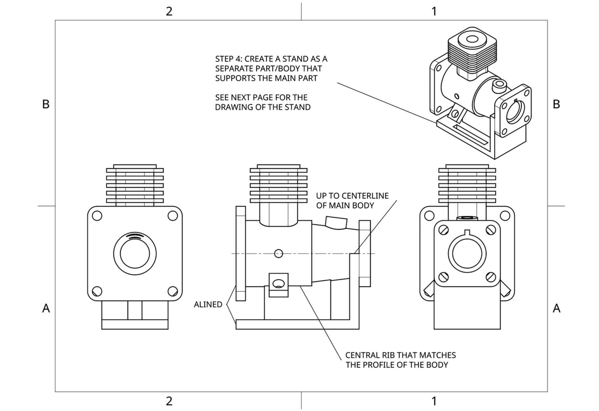

# Coding agents can design using CAD software

Unpublished bullet-point draft. [Open the Substack draft](https://ebilionis.substack.com/publish/post/222678896).

- Start with a concrete question: can a coding agent reconstruct a substantial CAD model from engineering drawings, inspect its work, and deliver editable source?

- Choose the four-stage task from [Deng, Chen and Olechowski (2024), “What Sets Proficient and Expert Users Apart?”](https://doi.org/10.1115/1.4063360) Their study involved 19 Onshape users and a 35-minute modeling task. This gives us a published case, although our CadQuery setup is an adaptation.

- Give the candidate the five participant drawing sheets from Appendix A and an explicit completion prompt. Start from an empty model. Build the flanged body, finned tower, angled features and holes, then a separate supporting stand. Preserve the original dimensions and drawing notes.

- Keep the evaluator separate. The candidate gets the participant drawings, description, CAD environment and local software documentation. Hold back the full paper, grading sheets, reference solutions and prior attempts.

- Provide three tools: run Python with CadQuery, inspect an image, and request a geometry check. Allow at most four full checker calls; ordinary builds, measurements, renders and repairs remain available.

- Enforce a restricted local sandbox. Candidate code can read only permitted inputs/runtime files and write only its work and scratch areas. Deny candidate network access, child processes and delegation. A separate controller handles model requests, tool admission, timing and evidence.

- Qualify the sandbox and checker before the trial: test allowed and forbidden actions, worker shutdown, time limits, snapshots, exports and clean rebuilding. Fix the failures and rerun the affected checks before launching the candidate.

- Freeze the scoring rules first. The paper says 60 grading dimensions, but Appendix B enumerates 61 distinct criteria (22 + 14 + 14 + 11). Keep all 61, fix tolerances, and leave unsupported or ambiguous measurements unresolved. This is an adapted 61-criterion rubric.

- Set a 35-minute progress checkpoint and a 60-minute cap. Count reading, modeling, builds, checks and repairs in the candidate time. Setup, evaluator development and later review are separate.

- Run one fresh candidate: GPT-6.1 Sol, xhigh. The request audit records 29 provider requests. The candidate uses one of four available geometry-check calls, alongside its own inspections.

- The candidate finishes in 11 minutes 16 seconds, including shutdown. It supplies parameterized source, six STEP exports, a README and inspection images. Because it finishes early, the planned checkpoint and final result use the same sealed snapshot; this is not a separate observation at minute 35.

- Rebuild from source in a clean restricted environment and independently reload the exports. All six exports match the rebuild. The assembly retains two separate solids, matches the individual part files, and has zero measured positive-volume overlap. Source review confirms shared geometry drives the stand’s support and hole locations.

- Evaluate 19 criteria automatically and 42 through AI-assisted operator review, using independent STEP measurements and source inspection. Check hidden passages, hole conditions, repeated features and support contact. This is not independent human signoff.

- The result is 60 of 61 criteria confirmed, with all criteria attempted and none established as incorrect or absent. All eight integrity and supplemental gates pass. Overall acceptance remains requires_review.

- The unresolved item is the paired blind holes: diameter 8.5 mm, cylindrical depth 5 mm, total depth about 7.554 mm with the candidate’s drill tips. The frozen requirement did not specify whether the 5 mm included the tips. Keep the ambiguity rather than changing the interpretation after seeing the result.

- Archive the original submission and evidence. Do not repair the candidate after the clock stops. Package the exact prompt, drawings, source, frozen rubric, result data and reproduction commands in a private repository.

- What this establishes: one coding-agent system completed almost all requirements of this drawing-reconstruction task in a short run. It does not establish reliability across tasks, manufacturing performance, human labor savings or a numerical speedup over the paper’s Onshape users. Tool conditions, feedback, scoring and review differ.
